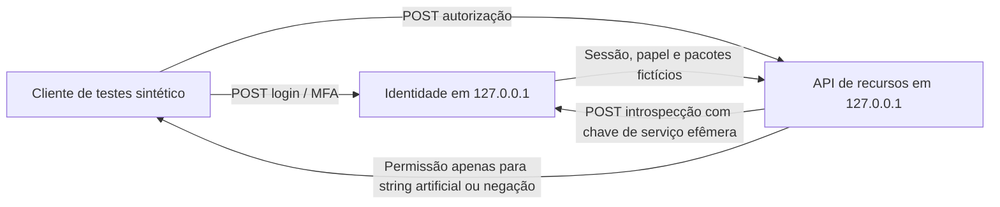

# Ciclo 41 — Integração HTTP entre serviços sintéticos isolados

**P&D v4.1.0 · 03/11/2026.** Continuidade do Ciclo 40: antes de conectar um provedor de identidade real, exercitar os limites entre serviços com dois processos independentes.

## Resultado e delimitação

O projeto agora possui **dois processos Python HTTP distintos**, comunicando-se exclusivamente por `127.0.0.1`, usando portas efêmeras e contas fictícias geradas a cada execução. Um processo é o **serviço de identidade do laboratório** e outro a **API de recursos sintéticos**. O harness inicia e finaliza ambos; não existe serviço remoto, banco de dados corporativo ou leitura de arquivos privados.

Este arranjo é um **ensaio HTTP local**; não é IdP OIDC, federação corporativa, JWT, OAuth 2.0, TLS/mTLS, SSO ou integração com homologação da empresa. O token é uma sessão proprietária HMAC, exclusivamente de ensaio. Respostas positivas contêm apenas identificadores sintéticos `SIMULATED-IRP-001` ou `SIMULATED-IRP-002`, sem abrir documentos do Ciclo 38.

## Fluxo de comunicação



A API de recursos não valida senhas nem assina sessões. Ela exige resposta da introspecção do serviço de identidade (chave temporária). Depois da introspecção, a API valida papel, ação e ID de recurso. O autor não lê casos privados; o revisor não adjudica; o adjudicador não substitui os revisores. Ações SAP/ECM, alteração de regra e liberação são recusadas.

## Execução dos testes

| Grupo | Quantidade | Resultado exigido |
| --- | ---: | --- |
| Ações com papel e recurso sintético compatíveis | 6 | Permitidas somente entre os serviços de laboratório |
| Ações fora do papel, recurso ou domínio autorizado | 6 | Negadas |
| Proteções adversariais via HTTP | 12 | Todas bloqueiam acesso indevido |
| Usuários corporativos, IdP, documentos privados e permissões reais | 0 | Nenhum acesso |

As 12 verificações adversariais abrangem senha incorreta, ausência de MFA, TOTP incorreto, TOTP repetido, introspecção sem chave, introspecção com chave errada, token adulterado, rota inexistente, campo de papel injetado, sessão desconhecida, sessão revogada e expiração de sessão.

Para testar expiração sem aguardar o TTL de 900 segundos, somente o ensaio inclui `POST /advance-clock`, protegido pela chave efêmera de serviço. **Esse endpoint de teste jamais deve existir em uma solução de produção.**

## Controles e riscos materiais

- `127.0.0.1` é validado no binding dos serviços e no cliente HTTP; a saída confirma dois PIDs diferentes (sem publicá-los).
- Requisições aceitam somente JSON com corpo até 4096 bytes. A API rejeita campos extras, inclusive uma tentativa de declarar `role` na requisição.
- Senhas e sementes TOTP são produzidas para contas fictícias e enviadas ao processo de identidade somente no ambiente efêmero; a chave de introspecção fica no ambiente dos dois processos, e tokens/segredos não aparecem nos relatórios.
- Credenciais, MFA, prazo e revogação são verificados no serviço de identidade; a API verifica funções e pacotes atribuídos sem acesso a documentos reais.
- O processo principal finaliza os subprocessos em `finally`, inclusive em caso de erro. Nenhum mecanismo de continuidade é criado.

### Limitações que os testes não resolvem

**HTTP sobre loopback não garante criptografia, autenticação mútua nem isolamento entre processos do mesmo usuário.** Um processo local com acesso às variáveis de ambiente pode recuperar a chave de serviço ou os dados fictícios. O segredo compartilhado não equivale a certificados de workload, TLS ou mTLS. O código de autenticação do laboratório não deve ser reutilizado em produção.

As portas efêmeras são selecionadas antes do binding, deixando uma pequena janela de corrida. Em uma implantação real, a arquitetura exigiria provisionamento seguro de sockets, segregação de usuários de serviço, gestão de segredos, identidade de workload, política de rede e verificação com equipe de segurança.

Também não há armazenamento persistente, revogação distribuída, observabilidade corporativa, auditoria externa, testes de concorrência/carga, IdP confiável, consentimento, titularidade de documentos, custódia real de OEM, conexão com SAP/ECM ou homologação de diagnósticos.

## Artefatos versionados

- `governance/loopback_http_services.py`: serviços HTTP de identidade, introspecção e recursos fictícios.
- `governance/loopback_service_harness.py`: geração de atores, processos, portas, testes e relatório sem segredos.
- `governance/loopback-service-policy.v1.json`: contrato de isolamento e proibições.
- `contracts/loopback-service-{policy,scenario,guard,report}.schema.json`: quatro contratos JSON Schema.
- `tests/test_loopback_service_lab.py`: integração HTTP real entre subprocessos e testes adversariais.

```bash
python -m unittest tests.test_loopback_service_lab -v
python -m governance.loopback_service_harness \
  --output build/benchmarks/cycle41-loopback-integration.json
```

Este procedimento utiliza somente os IDs públicos e fictícios da base anterior. Não requer senha, certificado ou documento corporativo.

## Próximo marco

Para testar OIDC de verdade, precisaríamos de um **IdP de homologação autorizado**, registro de cliente, fluxo adequado (Authorization Code com PKCE para clientes aplicáveis), biblioteca de validação conhecida, JWKS, audiência/emissor reais, sessões e autorização de backend por recurso. Isso depende de escolha de fornecedor, desenho de isolamento, autorização formal e dados exclusivamente sintéticos.

**Decisão:** `no_go_loopback_synthetic_http_only_no_external_idp_or_real_resources`. Zero usuários humanos autenticados externamente, zero tokens OIDC verificados, zero documentos privados acessados e zero ações operacionais.
